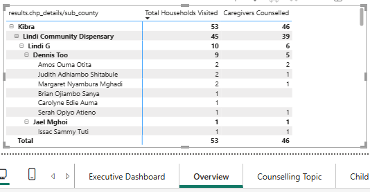
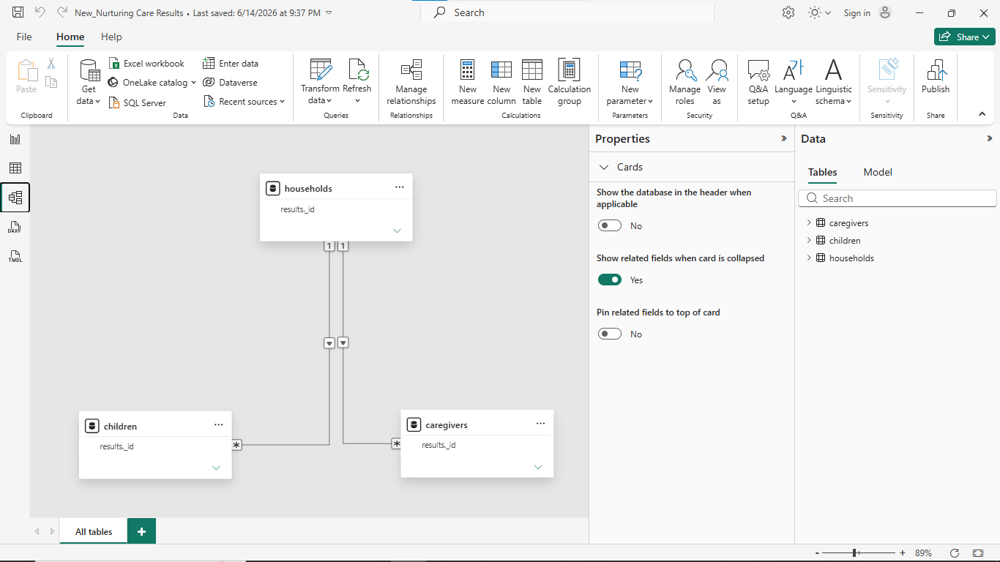
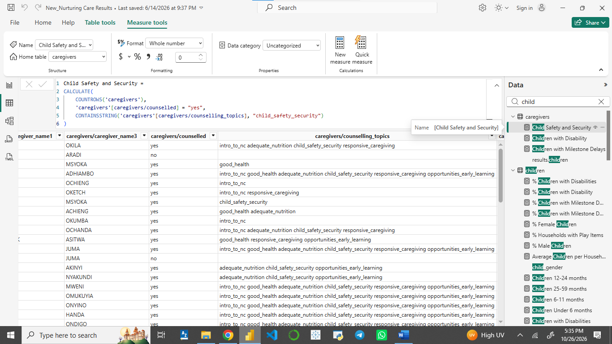

# Nurturing Care Results Dashboard

**Note on Data Privacy:** The live Power BI file (`.pbix`) and raw datasets are not included due to strict data privacy rules. The original data contains PII. The screenshots below demonstrate the technical work and dashboard layout without compromising sensitive information.

## Dashboard Screenshots

### Page 1: Executive Overview
*KPI cards, demographic breakdowns, and a custom drill-down matrix.*

### Page 2: Counselling Topics
*A clustered bar chart and matrix to track specific topics discussed with caregivers.*

### Page 3: Child Health & Play Items
*Tracks age demographics, disability status, milestone delays, and play items.*

### Drill-Down Capability
*Demonstrates the working location hierarchy (Sub County down to CHP level).*

### Data Modeling
*The relational model connecting Households, Caregivers, and Children.*

### DAX Implementation
*Example of the DAX logic used to parse multi-select questionnaire data.*

