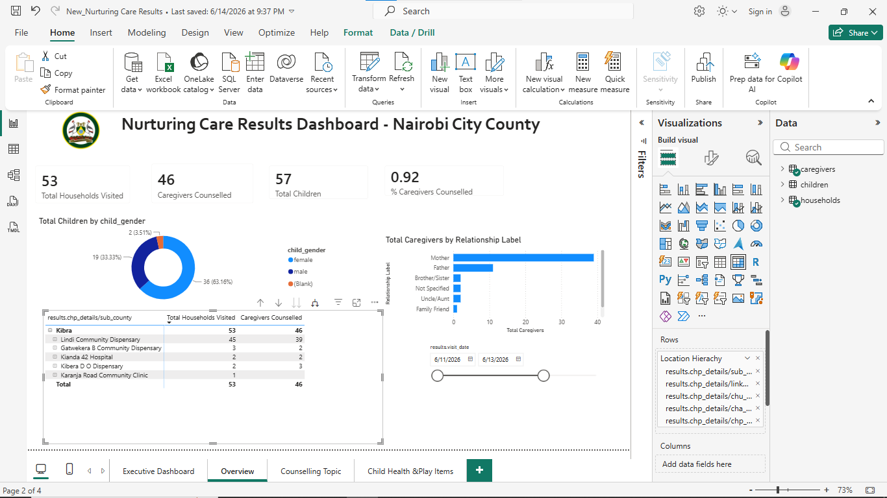
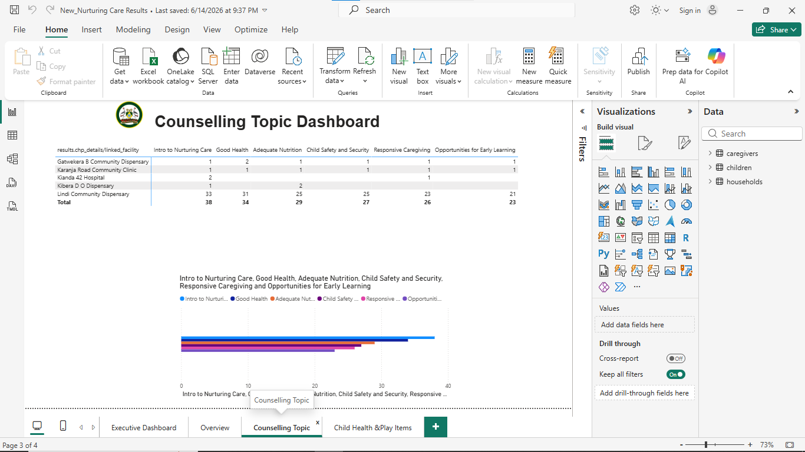
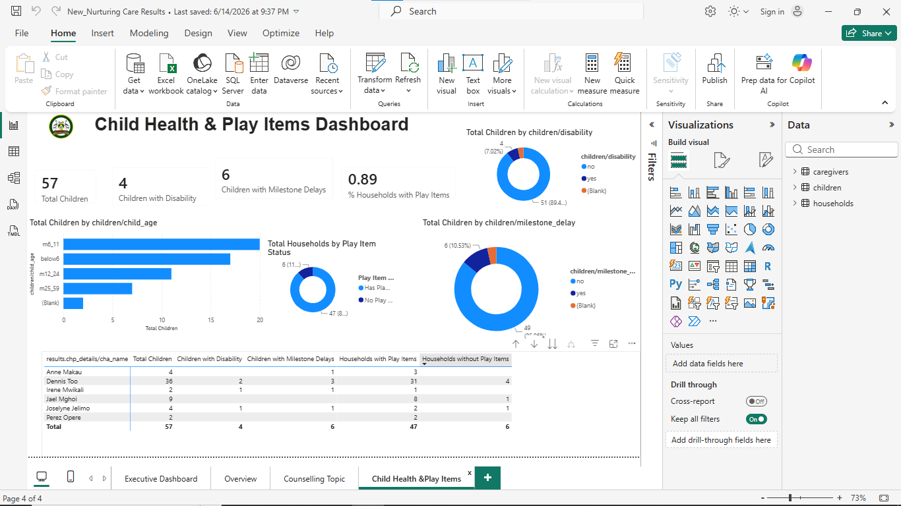

# Nurturing Care Results Dashboard

**Note on Data Privacy:** The live Power BI file (`.pbix`) and raw datasets are not included due to strict data privacy rules. The original data contains Personally Identifiable Information (PII) regarding caregivers and children. The screenshots below demonstrate the technical work and dashboard layout without compromising sensitive information.

## Project Background
This project involved building an executive reporting dashboard for a community health program in Nairobi City County. Data was collected by frontline health workers via KoboToolbox and exported as three separate, relational Excel files: Households, Caregivers, and Children. 

The goal was to transform this raw survey data into an interactive 3-page Power BI report that program managers could use to track household visits, counselling metrics, and child health indicators.

## The Business Problem & My Solution

**1. The Challenge: Broken Geographic Filtering**
The program operates on a strict hierarchy: Sub County → Facility → CHU → CHA → CHP. Initially, the drill-down matrix in Power BI failed to filter correctly, showing the same grand totals at every level. 
*   **My Solution:** I rebuilt the data model relationships and created a formal Power BI hierarchy. This allowed the visual matrices to accurately filter and cascade data down to the individual Community Health Promoter (CHP) level.

**2. The Challenge: Handling Multi-Select Survey Fields**
The KoboToolbox questionnaire allowed health workers to select multiple counselling topics per visit (e.g., a caregiver could receive both "Good Health" and "Nutrition" counselling in one session). Because these were stored as a single string of text, standard counting resulted in inaccurate totals.
*   **My Solution:** I wrote custom DAX measures using `CALCULATE` and `CONTAINSSTRING`. This logic parsed the text strings and accurately counted how many times each specific topic was discussed, ensuring a caregiver was counted for every topic they received.

## Dashboard Screenshots

### Page 1: Executive Overview
*KPI cards for total households, caregivers, and children. Includes the location hierarchy matrix with drill-down capabilities and a date slicer.*

### Page 2: Counselling Topics
*A clustered bar chart showing the six core Nurturing Care topics, alongside a matrix that allows managers to see which topics are being discussed in specific facilities.*

### Page 3: Child Health & Play Items
*Tracks child demographics by age, disability status, developmental milestone delays, and whether households have access to play items.*

### Drill-Down Capability
*Demonstrates the working location hierarchy in action (Sub County down to CHP level).*

### Data Modeling
*The relational model connecting Households, Caregivers, and Children.*

### DAX Implementation
*Example of the DAX logic used to parse multi-select questionnaire data and filter context.*

